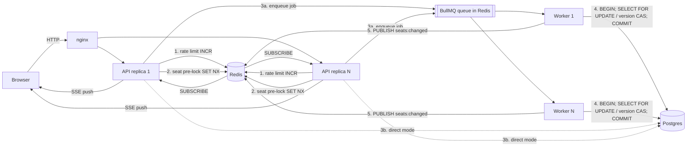
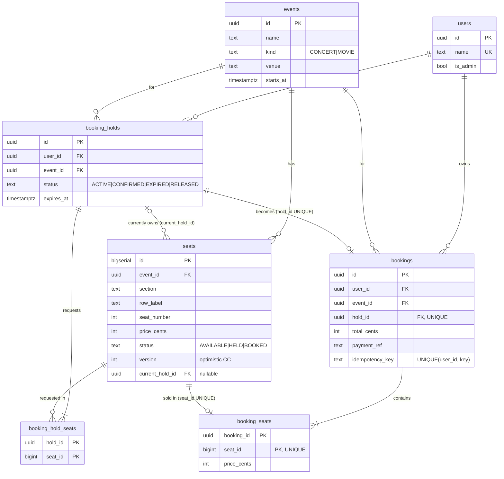

# DESIGN.md — Event Ticket Booking System

This document explains how the system works and why it is built this way. It
describes the code as it exists. File references point to the implementation,
and the numbers in §11 come from running the included load test.

**Correctness requirement: a seat must never be double-booked.** Every design
decision below either enforces that rule or keeps enforcing it cheap under
load.

---

## 0. Overview: how a booking request flows



A hold request passes through a series of defenses. Each one rejects as much
as it can, as cheaply as it can:

| # | Layer | Cost per request | What it stops | Can it be wrong? |
|---|-------|------------------|---------------|------------------|
| 1 | Rate limiter (Redis counter) | ~0.1 ms | One client hammering the endpoint | Fails open if Redis is down |
| 2 | Redis seat pre-lock (`SET NX`) | ~0.1 ms | The herd for an already-contested seat | Yes: a lease can expire or be lost in failover |
| 3 | Queue + admission control | ~1 ms | Too many simultaneous DB transactions | Only paces work, decides nothing |
| 4 | DB row lock / version CAS in a transaction | ~ms, uses a pool connection | Two transactions both claiming a seat | No, this layer enforces correctness |
| 5 | `UNIQUE` / `CHECK` constraints | Enforced by Postgres | Any bug in layers 1–4 | No |

Layers 1–3 exist for **performance**. Layers 4–5 exist for **correctness**.
If you delete layers 1–3 (the ticket-drop script can: `--no-redis-lock
--mode direct`), the system becomes slower and less stable. It never
double-books (§11).

Code map:

| Concern | File |
|---------|------|
| Schema, constraints, indexes | `backend/db/migrations/001_schema.sql` |
| Transactions, isolation, retry | `backend/src/db/tx.ts` |
| Connection pool (semaphore) | `backend/src/db/pool.ts` |
| Pessimistic strategy | `backend/src/booking/pessimistic.ts` |
| Optimistic strategy | `backend/src/booking/optimistic.ts` |
| Pipeline: pre-lock → queue/direct | `backend/src/booking/checkout.ts` |
| Confirm, payment, cancel, sweeper | `backend/src/booking/service.ts` |
| Queue + worker | `backend/src/queue/checkoutQueue.ts` |
| Redis lock / idempotency / rate limit / cache | `backend/src/redis/*.ts` |
| Ticket-drop simulation | `backend/src/sim/ticketDrop.ts` |

---

## 1. Schema



### Design choices

- **Normalized (3NF).** Holds and bookings reference seats through junction
  tables (`booking_hold_seats`, `booking_seats`) because they are many-to-many.
  Prices are copied into `booking_seats` on purpose: that's the price paid,
  which must not change if the seat's price changes later.
- **`seats.status` and `seats.current_hold_id` duplicate information on
  purpose.** "Who owns this seat right now" could be derived from the holds
  and bookings tables. We store it on the seat row because **the seat row is
  the thing we lock**. The lock target and the state it protects must be the
  same row. Otherwise you lock row A while deciding based on row B, which
  someone else can change.
- **Why `booking_hold_seats` exists as well as `current_hold_id`:** a hold
  must remember which seats it asked for even after it expires and another
  user takes them. Confirm then detects `SEATS_LOST` instead of silently
  booking fewer seats.

### Constraints that enforce the rules

| Constraint | Guarantees |
|------------|------------|
| `booking_seats UNIQUE (seat_id)` | **A seat appears in at most one booking.** If all application locking were broken, the second `INSERT` would still fail with `23505` and roll back the transaction. |
| `bookings UNIQUE (hold_id)` | A hold becomes at most one booking (no double confirm). |
| `bookings UNIQUE (user_id, idempotency_key)` | The durable half of idempotency (§7). |
| `seats CHECK ((status='HELD') = (current_hold_id IS NOT NULL))` | "HELD with no owner" and "BOOKED but still pointing at a hold" cannot be stored. |
| `seats UNIQUE (event_id, section, row_label, seat_number)` | Each physical seat exists once per event. |
| `CHECK` on every status column | No typo'd states. |

The unique constraint alone would not be enough. It catches double-booking
only at the **final** step (the booking). Two users could still both be shown
"seat held, you have 5 minutes, please pay", and one of them would then be
charged and refunded. The locking strategies prevent that earlier, at the
**hold** stage. The integrity check `seatsWithOverlappingHolds` verifies that
separately, because no constraint covers it.

---

## 2. The two locking strategies

Both implement the same interface (`LockStrategy` in `booking/types.ts`) and
can be swapped per deployment (`LOCK_STRATEGY`) or per request (`X-Lock-Strategy`
header, used by the load test to compare them).

### A. Pessimistic: `SELECT … FOR UPDATE` (`booking/pessimistic.ts`)

```sql
BEGIN ISOLATION LEVEL READ COMMITTED;
SELECT id, status, version, price_cents, current_hold_id
  FROM seats
 WHERE event_id = $1 AND id = ANY($2)
 ORDER BY id              -- consistent lock order => no deadlocks
 FOR UPDATE;              -- exclusive row locks; competitors BLOCK here
-- check status in app code (HELD by an expired hold counts as free)
INSERT INTO booking_holds ... RETURNING id, expires_at;
INSERT INTO booking_hold_seats ...;
UPDATE seats SET status='HELD', current_hold_id=$hold, version=version+1 WHERE id = ANY($2);
COMMIT;                   -- locks released
```

"Assume conflict, lock first." The check ("is it free?") and the write ("mark
it held") are atomic with respect to other bookers, because nobody else can
touch the rows in between.

### B. Optimistic: `version` column (`booking/optimistic.ts`)

```sql
BEGIN ISOLATION LEVEL READ COMMITTED;
SELECT id, status, version, ... FROM seats WHERE ...;        -- NO lock
-- check status in app code
INSERT INTO booking_holds ...;
UPDATE seats AS s
   SET status='HELD', current_hold_id=$hold, version = s.version + 1
  FROM unnest($ids, $versions_we_read) AS expected(id, version)
 WHERE s.id = expected.id
   AND s.version = expected.version       -- compare-and-swap
RETURNING s.id;
-- fewer rows returned than requested?  ->  ROLLBACK and retry from the SELECT
COMMIT;
```

"Assume no conflict, detect it at write time." If someone changed a seat
after we read it, their update increased `version`, our `WHERE` matches 0
rows, and we roll back (which also removes our hold row) and retry. The retry
reads the seat as `HELD` and fails fast with `SEATS_UNAVAILABLE`.

### Tradeoffs

| | Pessimistic | Optimistic |
|---|---|---|
| Behavior under conflict | Losers **wait**, then fail cleanly | Losers do the work, **roll back**, retry |
| Wasted work | None | Proportional to conflict rate |
| Connection held while waiting | Yes, a blocked transaction holds a pool slot | No waiting; brief row lock only during the `UPDATE` |
| Deadlock risk | Yes, **must** lock in a consistent order | Low (the `UPDATE` still takes row locks; same ordering applies) |
| Best when | Contention is **high** (hot seats) | Contention is **low** (normal browsing, users spread across seats) |
| Failure mode under extreme load | Lock queues → pool exhaustion → 503s | Retry storms → wasted CPU; `CONFLICT_RETRIES_EXHAUSTED` |

What surprised us in the measurements (§11): with a single hot seat and no
Redis filter, **optimistic was faster**. The reason: once the seat is HELD,
every pessimistic loser still takes an *exclusive lock* on that row just to
read "it's taken" and give up. So thousands of losers queue behind each other
one by one. An optimistic loser only reads (no lock) and gives up without
waiting. A cheap improvement would be a lock-free pre-check (`SELECT status`
without `FOR UPDATE`, bail early if it isn't available) before the
`FOR UPDATE`. We left it out so the two strategies stay easy to compare.

### Deadlock avoidance: one global lock order

Every code path acquires locks in this order: **hold row → seat rows (ascending id)**.

- `holdSeats` locks only seat rows, in `ORDER BY id`. It never updates old
  hold rows, even when it takes over a seat from an expired hold. That hold
  row is left for the sweeper. If `holdSeats` locked *seat → hold* while
  `confirmHold` locks *hold → seat*, the two could deadlock. The comment in
  `booking/shared.ts: findStaleHoldIds` explains this.
- `confirmHold`, `releaseHold` and the sweeper all lock the hold first, then
  its seats.
- The Redis pre-lock is all-or-nothing and never waits, so it cannot deadlock.
- If a deadlock (`40P01`) happens anyway, `withTransaction` retries it.

### Other race conditions handled

| Race | Handling |
|------|----------|
| Two confirms of the same hold (double-click with *different* keys) | `SELECT … FOR UPDATE` on the hold row (pessimistic) or a conditional `UPDATE … WHERE status='ACTIVE'` (optimistic). The second one sees `CONFIRMED` → `HOLD_NOT_ACTIVE`. Also `bookings.hold_id UNIQUE`. |
| Hold expires *during* confirm | Confirm locks the hold row; the sweeper uses `SKIP LOCKED` and passes over it. Confirm re-checks `expires_at > now()` under the lock. |
| Hold expired, not yet swept, another user grabs the seat, then the original user confirms | The seat's `current_hold_id` now points at the new hold → `SEATS_LOST`; the payment is refunded. |
| Payment succeeds but the booking transaction fails | Compensating `refund()` (`service.ts`). The payment call happens **outside** the transaction so row locks are never held across network I/O. |

---

## 3. Transaction isolation level

**Choice: `READ COMMITTED`** (Postgres' default), set explicitly on every
booking transaction: `BEGIN ISOLATION LEVEL READ COMMITTED` in `db/tx.ts`.
It is configurable (`BOOKING_ISOLATION`) so you can try the others.

Correctness comes from **explicit locking** (`FOR UPDATE`) or an **explicit
compare-and-swap** (`WHERE version = $v`), not from the isolation level. Both
work correctly at READ COMMITTED because of a specific Postgres behavior:

> When an `UPDATE`/`SELECT FOR UPDATE` under READ COMMITTED finds a row that a
> concurrent transaction has locked, it waits. After that transaction commits,
> Postgres **re-reads the newest version of the row** and re-checks the `WHERE`
> clause against it (the "EvalPlanQual" re-check). It does not keep using the
> old snapshot.

What each level does for this workload:

| Level | Plain `SELECT` then `UPDATE` (no lock, no version) | `FOR UPDATE` (pessimistic) | Version CAS (optimistic) | Cost |
|-------|-----|-----|-----|-----|
| READ UNCOMMITTED | Postgres treats it as READ COMMITTED | – | – | – |
| **READ COMMITTED** | **BROKEN: lost update / double hold.** T1 and T2 both read AVAILABLE, both update, and the last write wins. Two users are told they hold the seat. | Correct: T2 blocks, wakes up, re-reads the row, sees `HELD` | Correct: T2's `WHERE version=3` is re-checked against v4 → 0 rows | Lowest. No spurious aborts. |
| REPEATABLE READ | Safe for a single row: T2's `UPDATE` gets `40001 could not serialize access due to concurrent update`. It still allows **write skew** across *different* rows. | Correct; the waiter gets `40001` instead of re-reading → retried | Correct; same `40001` → retried | Aborts + retries replace waits |
| SERIALIZABLE | Safe, including write skew (SSI detects dangerous read/write dependency cycles) | Correct | Correct | **False-positive aborts** (see below) |

The code comment at the top of `pessimistic.ts` shows the interleaving that
each choice prevents.

**What we measured with SERIALIZABLE.** Running the ticket drop with
`BOOKING_ISOLATION=SERIALIZABLE` stayed correct (zero double-bookings). Some
**confirm** transactions were still aborted with
`40001 … Canceled on identification as a pivot` **even after 5 retries**,
although those confirms were for *different* holds and seats. SSI tracks
reads with *predicate locks*. These can be coarse (page- or relation-level),
so unrelated transactions that read overlapping index pages look like they
conflict. We now return `409 TX_CONFLICT` (nothing committed, safe to retry)
instead of a 500. The client's retry with the same idempotency key then
succeeds. The cost of SERIALIZABLE is extra aborts and retries, and you need
retry logic everywhere.

**Why not rely on SERIALIZABLE?** It would guard against anomalies we might
not have thought of, such as write skew. The price is a higher abort rate
exactly when you can least afford it (a ticket drop). Our invariants are all
*per-row*: one seat, one owner. Explicit row locks or a CAS on that row
protect them directly. READ COMMITTED + explicit locking is the standard,
predictable choice for this kind of workload. If we added a *cross-row*
invariant, for example "max 4 tickets per user per event" (reads many rows,
writes one), write skew would become possible. Then we'd need SERIALIZABLE,
an advisory lock, or a lock on a per-user summary row.

---

## 4. Indexes for the read path

```sql
CREATE INDEX idx_seats_event_status ON seats (event_id, status);
```

The hot read queries are "how many seats are available for event X" (event
list) and "which seats of event X are AVAILABLE":

```sql
SELECT count(*) FROM seats WHERE event_id = $1 AND status = 'AVAILABLE';
```

- **Without it:** a sequential scan over every seat of every event.
  With 10,000 events × 50,000 seats = 500M rows, each request reads all of
  them.
- **With it:** a B-tree lookup on `(event_id, status)`. That's O(log N) to
  find the slice, then only the matching entries. Postgres can answer the
  count as an **index-only scan** (verified with `EXPLAIN`: `Index Only Scan
  using idx_seats_event_status`) and never touches the table.
- **Column order matters.** `event_id` comes first because every query filters
  on it with equality. The same index then also serves "all seats of event X"
  (full seat map) through its left prefix. `(status, event_id)` would be worse:
  `status` has only 3 values, so the first level of the tree narrows almost
  nothing.
- **Write cost.** Every status change updates this index entry too. That is
  acceptable because reads outnumber writes by orders of magnitude.
  (A status change also blocks Postgres' HOT update optimization for that
  row, since an indexed column changed.)

Other indexes:

- `idx_holds_active_expiry ON booking_holds (expires_at) WHERE status='ACTIVE'`:
  a **partial** index for the sweeper. It holds only live holds, so it stays
  small no matter how much history builds up.
- `idx_seats_current_hold` (partial, non-null): "release all seats of hold H"
  without a scan.
- Primary keys / unique constraints create their own indexes
  (e.g. `booking_seats(seat_id)`).

---

## 5. Thundering herd: the queue as an OS scheduler

A **ticket drop** means 10:00:00, sales open, and 50,000 people click at once.
The contended resource is Postgres: a few dozen connections and a handful of
hot rows.

### OS analogy

| Operating system | This system |
|---|---|
| Processes that become *ready* | HTTP hold requests arriving |
| Ready queue (run queue) | BullMQ `checkout-holds` queue in Redis (FIFO) |
| CPU cores that dispatch work | Worker processes × `WORKER_CONCURRENCY` |
| Scheduler time slice / rate policy | BullMQ `limiter` (`QUEUE_RATE_PER_SEC`), enforced globally via Redis |
| **Counting semaphore** guarding a resource | **DB connection pool** (`DB_POOL_SIZE`) |
| `P()` / `wait()` | `pool.connect()`: take a permit or block |
| `V()` / `signal()` | `client.release()` |
| Admission control / refusing to fork more processes | `MAX_QUEUE_DEPTH` → `503 QUEUE_FULL` |
| **Thrashing** (too many processes competing for RAM, nobody makes progress) | Thousands of transactions contending for 10 connections and one row lock. Timeouts, lock-wait pile-ups, latency collapse. |

Without the queue (`CHECKOUT_MODE=direct`), every API request goes straight to
`pool.connect()`. The pool is a semaphore with 10 permits, and its wait queue
is in-process and unbounded. Under a herd, waiters accumulate. When one has
waited `DB_POOL_ACQUIRE_TIMEOUT_MS` (5s), it gives up with `503 DB_OVERLOADED`.
We measured this: 706 of 5,000 requests failed this way (§11). Pessimistic
waiters make it worse, because a transaction blocked on a row lock *keeps its
permit* while it waits.

With the queue (`CHECKOUT_MODE=queue`), the API does not touch the DB for
holds. It enqueues a job and waits for the result (`job.waitUntilFinished`).
An HTTP request waiting on a Redis event costs a few KB of memory: no DB
connection and no thread. Workers pull jobs at a controlled concurrency, so
Postgres sees a **steady, bounded** amount of work. Same load: **0 errors**.

The queue is not faster. On an idle system it adds a few ms (enqueue →
dispatch → completion event). It makes the system stable: bounded DB load,
FIFO fairness, no timeouts. For a ticket drop, fairness and "everyone gets an
answer" matter more than shaving a few ms off p50.

If a job hasn't finished within `QUEUE_WAIT_TIMEOUT_MS`, the API answers
`202 {jobId}` and the client polls `GET /api/hold-jobs/:jobId`. That keeps
HTTP timeouts short even when the queue is long.

### Pool sizing

`DB_POOL_SIZE=10` per process, `WORKER_CONCURRENCY=8`.

- **Postgres runs one OS process per connection.** Past roughly
  `(2 × CPU cores) + effective disks` *active* connections, adding more only
  adds context switching and lock contention. This is the well-known
  PostgreSQL wiki / HikariCP rule of thumb. For a 4-core DB that's about
  10 active connections in total. More connections gives *less* throughput,
  the same way more runnable processes than cores gives more context
  switches, not more work done.
- **Worker concurrency ≤ pool size.** Extra jobs would only block on
  `pool.connect()` while holding a job lease. The remaining 2 permits go to
  the sweeper and occasional reads.
- **Budget across replicas:** `(api replicas + worker replicas) × DB_POOL_SIZE`
  must stay under Postgres' `max_connections` (set to 200 in docker-compose).
  At real scale you'd put **PgBouncer** (transaction pooling) in front, so
  hundreds of app connections share a few dozen server connections. That is
  one global semaphore instead of one per process.

---

## 6. Redis distributed lock: in front of the DB lock, not instead of it

`redis/lock.ts` implements a single-instance Redis lock (`SET key token NX PX
ttl`, the building block of Redlock), extended with a Lua script that locks
**several seats all-or-nothing**. Release is compare-and-delete: only delete
if the value is still *our* token. Otherwise an expired-and-re-acquired lock
could be deleted by its previous owner.

**Why put it in front of the DB:** in a drop, 5,000 people want seat A1.
Without the pre-lock, all 5,000 go through the queue and take a DB connection
just to learn "taken". With it, one request per seat gets past Redis. The
other 4,999 get `409 SEAT_LOCKED` in about 0.1 ms and never touch the queue
or Postgres. In our run, 1,959 of 2,000 requests were stopped here (§11). It
filters cheaply so the expensive layer (Postgres) only sees requests that can
succeed.

**Why not instead of the DB lock:**

1. **A Redis lock is a lease, not a mutex.** It expires after its TTL even if
   the holder is still working: a GC pause, a slow queue, a stalled
   container. Two workers can then both believe they own the seat.
2. **Failover loses locks.** Redis replication is asynchronous. A primary can
   acknowledge `SET NX`, crash before replicating it, and the promoted replica
   has never heard of the lock. Redlock (5 independent masters) narrows this
   window, but Martin Kleppmann's well-known critique shows it still cannot
   guarantee safety without fencing tokens.
3. **Postgres already has the truth.** The seat row and its lock live in the
   same ACID system that records the booking. Checking and writing there is
   atomic. Redis is a separate system with no transaction linking it to the
   DB write.

So correctness never depends on Redis. If Redis loses a lock, two requests
reach Postgres and the row lock / version check resolves it. You can test this
with `--no-redis-lock`.

Implementation notes:

- The lock key uses a Redis Cluster hash tag, `lock:{evt:<eventId>}:seat:<id>`.
  All seats of an event land in the same slot, so the multi-key Lua script
  still works on a Redis Cluster.
- In queue mode the API takes the lock and the **worker releases it** after
  the DB commit (the token travels in the job payload). The TTL
  (`REDIS_LOCK_TTL_MS`, 30s) covers queue wait + transaction.
- The lock is released right after the DB decides. From then on the DB row
  (`HELD`) is the source of truth for the next 5 minutes.

---

## 7. Idempotency

`POST /api/holds/:id/confirm` requires an `Idempotency-Key` header. The client
creates one random key per payment attempt and reuses it on every retry of
that attempt. See `CheckoutPage.tsx`: the key lives in a `useRef`, so a
double-click sends the same key twice. After a *declined* payment the client
creates a new key, because that is a new attempt.

Two layers (`redis/idempotency.ts` + DB constraint):

```
request(key K, hold H)
  │
  ├─ Redis SET idem:{user}:{K} {processing, fp=H} NX EX 60
  │    ├─ claimed → run it ─┬─ success/business failure → store {done, status, body} EX 24h
  │    │                    └─ unexpected crash → DEL (let the retry run)
  │    └─ already exists:
  │         ├─ fingerprint ≠ H     → 422 IDEMPOTENCY_KEY_REUSED (client bug)
  │         ├─ processing          → 409 IDEMPOTENCY_IN_PROGRESS (retry shortly)
  │         └─ done                → replay stored status + body (header Idempotent-Replayed: true)
  │
  └─ inside the confirm:
       ├─ SELECT booking WHERE (user, K)  → if found, replay it (Redis lost the record)
       ├─ mock charge (provider also receives K; real providers dedupe on it)
       └─ INSERT bookings(... idempotency_key=K)  -- UNIQUE(user_id, idempotency_key)
             └─ 23505? a concurrent duplicate won → refund ours, replay theirs
```

- **Redis** handles the fast, common cases: a double-click while the first
  request is running, or a client retry after a timeout.
- **Postgres** makes it durable. Even if Redis were wiped, a second booking
  with the same key cannot exist. Declined payments are stored only in Redis
  (no booking row is created), so replaying one for 24h is fine.
- **The fingerprint** (hold id) stops a key from being reused for a different
  request. Such a reuse would otherwise silently return the wrong booking.

**Double-charge prevention** combines three things. The same key is sent to
the payment provider (the provider dedupes). At most one booking can exist per
key. Any charge whose booking fails is refunded.

The ticket-drop test sends every confirm twice at the same instant, then once
more afterwards. Measured result: exactly one `201 BOOKED` and one
`409 IDEMPOTENCY_IN_PROGRESS` per pair, the late retry replays the same
booking id, and distinct bookings = holds.

---

## 8. Rate limiting

`redis/rateLimit.ts`: a **fixed-window counter** in Redis
(`INCR rl:<scope>:<id>:<window>` + `EXPIRE` on the first hit, done atomically
in Lua). Applied to the hold and confirm endpoints:

- per **IP** (`RATE_LIMIT_IP_MAX` per 10s): stops one machine from spraying
  requests under many fake user ids;
- per **user** (`RATE_LIMIT_USER_MAX` = 20 per 10s): stops one account from
  hammering.

The counters live in Redis, so the limit is **global across replicas**. An
in-memory limiter would give each replica its own budget, and the effective
limit would grow with every server you add. Tradeoff: a fixed window allows a
2× burst at window boundaries. A sliding-window log or token bucket would be
smoother at more Redis cost. If Redis is down, the limiter **fails open**:
correctness is protected by the DB, so availability comes first.

The load test sends everything from one IP, so docker-compose sets
`RATE_LIMIT_IP_MAX` high. The per-user limit stays at 20.

---

## 9. Holds and expiry

- A hold lasts `HOLD_TTL_SECONDS` (300). `expires_at` is set by the database
  clock (`now() + interval`), not by any app server's clock.
- **Lazy expiry:** every read and every lock decision treats "HELD by an
  expired hold" as available (`findStaleHoldIds`, and the seat-map query's
  `CASE`). Correctness does **not** depend on the sweeper running on time.
- **Eager cleanup:** the worker runs `sweepExpiredHolds()` every 5s:

  ```sql
  UPDATE booking_holds SET status='EXPIRED'
   WHERE id IN (SELECT id FROM booking_holds
                 WHERE status='ACTIVE' AND expires_at <= now()
                 ORDER BY expires_at LIMIT 500
                 FOR UPDATE SKIP LOCKED)
  RETURNING id, event_id;
  UPDATE seats SET status='AVAILABLE', current_hold_id=NULL, version=version+1
   WHERE current_hold_id = ANY($expired_ids);
  ```

  `FOR UPDATE SKIP LOCKED` is the standard work-queue-in-a-table pattern. Any
  number of worker replicas can run the sweeper at once without processing the
  same hold twice or blocking each other. It also skips a hold that a confirm
  currently has locked.

---

## 10. Scalability

This is a **modular monolith**: one codebase, one image, two process roles
(`api`, `worker`). Its internal seams are where it would be split later.

### Stateless API → horizontal scaling (implemented)

- No server-side sessions. Auth is a signed token (HMAC) that any replica can
  verify without a lookup (`http/auth.ts`).
- All shared state is in Postgres (truth) or Redis (locks, rate-limit
  counters, idempotency records, queue, cache, pub/sub).
- Real-time updates work across replicas: whichever process commits a change
  does `PUBLISH seats:changed`. Every API replica is subscribed and pushes to
  its own SSE clients.
- Try it: `docker compose up --scale api=3 --scale worker=2`. nginx
  load-balances across the replicas, and `/api/health` reports which
  `instance` answered. We ran the ticket drop through nginx with 2 API
  replicas: zero double-bookings.

### Read replicas for the browse path

`GET /events`, `GET /events/:id/seats` and the SSE stream are ~99% of
traffic, and a few hundred ms of staleness is fine for them. To scale:

1. Add Postgres streaming replicas.
2. Create a second pool (`readPool`) pointed at the replicas (or at a
   PgBouncer/HAProxy in front of them). Use it in `routes/events.ts` only.
3. **Never** use a replica on the booking path. `holdSeats`/`confirmHold` must
   read and lock on the primary, because replicas lag and can't take
   `FOR UPDATE` locks. The lazy-expiry logic already tolerates slightly stale
   reads on the browse path, and the booking path always re-checks under a
   lock on the primary.
4. Read-your-writes: after a user books, their own "My bookings" should read
   from the primary for a few seconds (or wait for the replica to reach the
   commit's LSN).

### Caching hot events in Redis (implemented)

The seat map is cached **cache-aside** with a 2-second TTL
(`redis/seatEvents.ts`), and every seat change invalidates it
(`seatsChanged()`). During a drop where 10,000 browsers watch one event, SSE
tells each of them "changed", and they all re-fetch. Postgres sees one query
per 2-second window for that event, and everyone else is served from Redis
(`X-Cache: hit|miss` header). Correctness never depends on the cache: a stale
map can only cause a `409` when booking, never a double-booking. Next steps at
larger scale:

- **Stampede protection.** When the key expires, many readers miss at once.
  Fix with a short Redis lock around the reload (one reader rebuilds, others
  wait or serve stale data) or with probabilistic early refresh.
- **Delta updates.** Push the changed seat ids over SSE instead of "changed,
  re-fetch", so clients patch their map instead of reloading it.
- A per-event **available count** kept in Redis (`DECR` on hold, `INCR` on
  release), so the "sold out?" check never reaches Postgres.

### Sharding bookings by `event_id`

All booking-path contention is **within one event**. No transaction touches
two events. That makes `event_id` a natural shard key:

- `seats`, `booking_holds`, `booking_hold_seats`, `bookings`, `booking_seats`
  all carry `event_id` directly or through their parent. Shard all of them by
  `event_id`, so a booking transaction is always **single-shard**: no
  distributed transactions or 2PC.
- Routing: `shard = lookup(event_id)`, using a directory table ("event X lives
  on shard 3") rather than `hash(event_id) % N`. The directory lets you **move
  one mega-event** (a Taylor Swift drop) onto a dedicated shard without
  reshuffling everything else. Citus does this with `event_id` as the
  distribution column.
- `users` is small and global. Replicate it to every shard, or keep it on a
  central DB and reference it only by id.
- "My bookings" becomes a cross-shard query. Serve it from a per-user
  projection (e.g. a `user_bookings` table fed by events/CDC), not by querying
  every shard.
- The queue shards the same way: one BullMQ queue per hot event (or per shard),
  so a mega-drop can't starve other events. The code's `CHECKOUT_QUEUE` name
  becomes `checkout-holds:{shard}`.
- Redis keys already use the `{evt:<id>}` hash tag, so seat locks for one
  event stay on one Redis Cluster node.

### How the monolith would split apart (and why it hasn't)

| Future service | Today's module | Talks to |
|---|---|---|
| Catalog / browse (read-heavy, replicas + cache) | `routes/events.ts`, `adminService.createEvent` | read replicas, Redis |
| Inventory / booking (write-heavy, sharded by event) | `booking/*`, `queue/*`, sweeper | primary DB shard, Redis |
| Payments | `booking/payment.ts` | external provider |
| Notifications / realtime | `redis/seatEvents.ts`, SSE route | Redis pub/sub |

The seams already exist as module boundaries. Splitting them into separate
services adds network hops, partial failures and distributed transactions (the
payment step would need a saga). At this project's scale that's pure cost.
Split when a module needs to *scale* or *deploy* independently. The inventory
service, sharded by event, would be first.

---

## 11. Measured results

These are single runs on a Windows laptop (Docker Desktop, API + worker via
`tsx`, Postgres/Redis in containers). The load generator runs on the same
machine, so absolute latencies are pessimistic. Compare them with each other,
not against production numbers. Reproduce with `npm run ticket-drop -- …`.

**(a) Full stack, 2,000 requests, concurrency 300, 1,000 users, 10 hot seats,
2 seats per request** (`--compare`):

| Strategy | Mode | Holds granted | Stopped by Redis | p50 | p95 | p99 | Result |
|---|---|---|---|---|---|---|---|
| pessimistic | queue | 5 | 1,959 | 273 ms | 891 ms | 910 ms | PASS |
| pessimistic | direct | 4 | 1,980 | 226 ms | 479 ms | 528 ms | PASS |
| optimistic | queue | 4 | 1,957 | 260 ms | 601 ms | 760 ms | PASS |
| optimistic | direct | 4 | 1,973 | 210 ms | 551 ms | 600 ms | PASS |

About 98% of requests never reached Postgres. At most 5 holds can succeed
(10 seats ÷ 2); fewer when two winners' seat pairs overlap and leave a gap.

**(b) Same load, Redis pre-lock disabled** (`--compare --no-redis-lock`),
so the whole herd reaches the DB:

| Strategy | Mode | p50 | p95 | p99 | 5xx | Result |
|---|---|---|---|---|---|---|
| pessimistic | queue | 1,654 ms | 3,037 ms | 3,440 ms | 0 | PASS |
| pessimistic | direct | 924 ms | 1,061 ms | 1,312 ms | 0 | PASS |
| optimistic | queue | 615 ms | 822 ms | 973 ms | 0 | PASS |
| optimistic | direct | 737 ms | 936 ms | 1,216 ms | 0 | PASS |

The DB locks alone keep the system correct. Latency is 3–6× higher than in
(a), which shows what the Redis layer saves.

**(c) Worst case: 5,000 requests, concurrency 1,000, ONE hot seat, no Redis
pre-lock, no confirm:**

| Strategy | Mode | Granted | 409 | **503 DB_OVERLOADED** | p50 | p99 |
|---|---|---|---|---|---|---|
| optimistic | direct | 1 | 4,999 | 0 | 3.5 s | 6.0 s |
| optimistic | queue | 1 | 4,999 | 0 | 2.6 s | 5.4 s |
| pessimistic | direct | 1 | 4,293 | **706** | 5.0 s | 8.4 s |
| pessimistic | queue | 1 | 4,999 | **0** | 6.2 s | 8.7 s |

This is the semaphore argument from §5 in numbers. Pessimistic + direct lets
1,000 requests fight over 10 pool permits while each winner holds its permit
waiting on the same row lock. 14% of requests time out on the pool. The same
load through the queue gives zero errors: slower, but everyone gets a real
answer. Optimistic suffers less because its losers don't wait on locks.

**(d) `BOOKING_ISOLATION=SERIALIZABLE`**, direct mode, no Redis: correct in
every run (PASS). 1–3 out of ~9 confirms per run exhausted 5 retries with
`40001` (predicate-lock false positives, §3), got `409 TX_CONFLICT`, and
succeeded on the client's idempotent retry.

In every run, every check reported zero: seats granted twice, holds with more
than one booking, double-booked seats (SQL), overlapping live holds (SQL), and
status/booking mismatches (SQL).

---

## 12. Known limitations (intentionally out of scope)

- Mock auth: no passwords, and tokens don't expire.
- No cancellation or refund of *confirmed* bookings. Adding it would turn
  `booking_seats UNIQUE(seat_id)` into a partial unique index on active
  bookings.
- Single Redis instance, no Redlock quorum. Acceptable because Redis is not
  relied on for correctness (§6).
- The admin UI's ticket drop runs the load generator inside the API process,
  which inflates latency. Use the CLI for cleaner numbers.
- The `X-Lock-Strategy`, `X-Checkout-Mode` and `X-Redis-Lock` headers are
  demo switches for comparing strategies. A production system would pick one
  path and not let clients choose.
